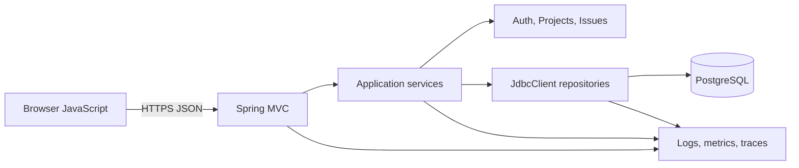

# Phase 10: Ship Trackr End to End

## Purpose

Integrate the roadmap into a portfolio-grade Spring Boot/PostgreSQL modular monolith with a small JavaScript browser client, then prove its journeys, concurrency, security, failure behavior, deployment, and operations as one system.

## Table of Contents

- [Overview](#overview)
- [Agent & Skills](#agent--skills)
- [Philosophy and Scope](#philosophy-and-scope)
- [Final Architecture and Contracts](#final-architecture-and-contracts)
- [PostgreSQL-Only Cutover](#postgresql-only-cutover)
- [User Journeys](#user-journeys)
- [Backend Milestones](#backend-milestones)
- [Frontend Milestones](#frontend-milestones)
- [Security, Reliability, and JVM Evidence](#security-reliability-and-jvm-evidence)
- [Testing and Accessibility](#testing-and-accessibility)
- [Delivery and Observability](#delivery-and-observability)
- [Decision Rules and Trade-offs](#decision-rules-and-trade-offs)
- [Common Pitfalls](#common-pitfalls)
- [AI-Assisted Workflow](#ai-assisted-workflow)
- [Review Rubric and Demo](#review-rubric-and-demo)
- [Hands-On Exercises and Evidence](#hands-on-exercises-and-evidence)
- [Exit Exercise](#exit-exercise)
- [Related Documents](#related-documents)

## Overview

The capstone tests integration and judgment. Trackr succeeds only when a browser journey, Spring MVC contract, application policy, JdbcClient transaction, PostgreSQL invariant, JVM concurrency boundary, security control, telemetry signal, and deployable artifact agree. A polished screen over unsafe persistence is not complete; neither is a clean package graph nobody else can run.

## Agent & Skills

- **Agents:** `backend-architect`, `frontend-architect`, `developer`, `tester`
- **Skills:** `plan`, `postgres-pro`, `javascript-pro`, `web-frontend`, `test`
- **Handoff:** give Phase 11 a stable `Summarizer` seam, redaction and budget policy, timeout conventions, deterministic test seam, and a fully deployable provider-disabled baseline.

## Philosophy and Scope

Build vertical slices. Registration is done when a browser handles valid and invalid input, establishes an opaque session, preserves it after refresh, and produces diagnosable telemetry. This approach exposes contract and transaction mismatches sooner than separate frontend/backend phases.

The final product is one Spring Boot/PostgreSQL modular monolith. Company JDK, Spring, Maven, package, and deployment conventions come first; otherwise the baseline is JDK 25 LTS, the current stable Spring Boot 4.1 service release, Maven Wrapper, and Spring MVC. WebFlux is out of scope unless an end-to-end reactive, measured need has already earned it.

Required scope:

- registration, login, logout, session restoration, expiry, and revocation;
- projects and project-scoped membership roles;
- issue CRUD, assignment, labels, comments, and closing;
- filtering and bounded cursor pagination;
- optimistic conflict handling, safe errors, audit events, and request correlation;
- durable outbox processing with bounded concurrency and idempotent effects;
- reproducible deployment of the browser assets, Spring Boot service, and PostgreSQL.

Non-goals: microservices, Kubernetes, event sourcing, billing, social login, chat, a framework comparison, or production MongoDB in the final runtime. Extras never displace failure, migration, accessibility, and rollback gates.

## Final Architecture and Contracts

The request path is explicitly **Browser → Spring MVC → application services → JdbcClient → PostgreSQL**. Controllers own HTTP translation, not business policy or transaction choreography. Application services own use cases, authorization, and transaction boundaries. Capability packages (`auth`, `projects`, `issues`) define domain language; infrastructure packages adapt JDBC, clock, outbound notification, and telemetry concerns.

Use immutable validated request/application DTOs and explicit response models. Do not expose database rows or mutable entities directly. OpenAPI defines schemas, session/CSRF behavior, error envelopes, cursors, versions, and statuses. Flyway defines durable storage. The JavaScript client uses one typed request boundary rather than scattered assumptions.

Model users, projects, memberships, issues, labels, issue labels, comments, sessions, idempotency records, outbox, and audit events relationally. Foreign keys, uniqueness, checks, `NOT NULL`, and version predicates protect invariants under concurrency.

## PostgreSQL-Only Cutover

Phase 5 produced a production-conscious MongoDB implementation; Phase 6 established the PostgreSQL schema and a clean application-owned persistence boundary. Complete the cutover before capstone polish:

1. freeze and document the source MongoDB model and cutover window;
2. migrate data through a restartable, auditable transformation into Flyway-managed PostgreSQL schema;
3. reconcile counts plus domain invariants, sampled records, ownership, versions, timestamps, and relationships;
4. switch the repository adapter at one controlled boundary;
5. run contract, browser, and concurrent invariant checks against PostgreSQL;
6. keep rollback artifacts for the cutover window without adding dual writes;
7. remove MongoDB runtime configuration, driver, health checks, repository implementation, deployment service, and obsolete tests after acceptance.

The final deployment is **PostgreSQL-only**. Do not retain dual-write, shadow-write, polyglot persistence, feature-flagged Mongo repositories, or a compatibility alias. A rollback restores a known pre-cutover system/data snapshot or rolls forward deliberately; it does not create two authorities.

## User Journeys

Implement in risk-first order:

1. register, log in, restore a session, log out, and reject invalid credentials uniformly;
2. create a project and owner membership atomically;
3. create, list, open, edit, and close an issue using version checks;
4. add a member, assign/label an issue, and comment within project scope;
5. filter and cursor-paginate with stable ordering;
6. recover from validation, conflict, unauthorized, timeout, and unavailable states without losing useful input;
7. commit a required mutation plus an outbox event and tolerate worker replay.

For each journey capture happy path, boundary, abuse/failure path, committed result, and request/trace ID. Reload after mutations so client-only state cannot masquerade as durability.

## Backend Milestones

1. Validate configuration and compose dependencies in normal Spring Boot configuration without hiding policy in annotations.
2. Apply ordered Flyway migrations and start only with a compatible schema.
3. Implement Spring Security opaque sessions, password encoding, CSRF, login throttling, and project authorization.
4. Use parameterized JdbcClient/named SQL, application-owned transactions, stable cursor reads, and versioned updates.
5. Commit issue changes, audit entries, idempotency records, and outbox events in the correct transaction.
6. Run bounded workers with explicit executor/semaphore capacity, interruption handling, retry classification, leases, and idempotent effects.
7. Add structured logs, Micrometer metrics, OTLP traces, secured Actuator health, and approved JFR diagnostics.

Keep SQL and transaction ownership visible. Hikari limits derive from total PostgreSQL capacity and measured workload, not servlet or virtual-thread concurrency.

## Frontend Milestones

Use the repository’s established JavaScript conventions. One request client includes credentials and the CSRF token, maps the stable error envelope, propagates `AbortSignal`, and handles `401` consistently.

Build login, project list/create, issue list/detail/edit, membership, and comments as complete slices. Show loading, empty, validation, denial, conflict, rate-limit, and dependency states. Never assume an optimistic local mutation committed. On `409`, retain edits and offer refresh/reapply rather than blind retry.

Allowlist filters/sorts and keep cursors opaque. Cancel obsolete fetches so stale responses cannot replace newer results. Hiding a control improves UX; server-side state and project authorization remain authoritative.

## Security, Reliability, and JVM Evidence

Demonstrate, do not merely describe:

- two-tenant horizontal authorization denial through HTTP and SQL scope;
- opaque-session rotation/revocation plus CSRF failure behavior;
- simultaneous versioned edits with exactly one accepted transition;
- bounded executor or semaphore behavior under outbox backlog;
- interruption-aware shutdown with unfinished durable events reclaimable;
- idempotent replay after a simulated worker crash;
- Hikari saturation behavior without an unbounded servlet/virtual-thread pile-up;
- JFR and thread-dump interpretation during controlled contention.

Java has no standard Go-style dynamic race detector. Therefore the capstone’s JVM concurrency evidence must combine JMM reasoning, invariant-focused concurrent tests, repeatable stress scenarios, database constraints, JFR, and thread dumps without claiming any one proves the absence of races.

## Testing and Accessibility

Keep only tests that defend a plausible consumer-visible bug:

- JUnit/AssertJ unit tests for domain transitions, policy, retry classification, cursors, and interruption;
- MockMvc tests for validation, statuses, envelopes, sessions, CSRF, and authorization;
- Testcontainers PostgreSQL tests for Flyway, JdbcClient queries, transactions, constraints, locks, versions, and outbox claims;
- OpenAPI/client contract checks and a few real browser journeys;
- concurrent/stress scenarios for durable invariants and bounded resources.

Use semantic HTML, associated labels/errors, logical focus, visible focus, sufficient contrast, and non-color status cues. Verify login, issue creation, filtering, conflict recovery, and error correction using keyboard only and one screen reader. Check zoom, narrow viewport, and reduced motion.

## Delivery and Observability

Build a layered non-root JRE image once and promote its digest. Apply Flyway through the controlled release step. Configure JVM/container memory headroom, Hikari capacity, request/shutdown budgets, and graceful drain. The deployment contains Spring Boot, browser assets, and PostgreSQL—no MongoDB service or driver.

Correlate request/trace context through Spring MVC, application service, JdbcClient, and outbox. Redact telemetry. Measure HTTP rate/error/duration, Hikari pressure, SQL latency, executor queue/rejection, outbox age, dependency outcomes, heap/GC/thread health, and security denials. Define one user SLO and actionable alert.

Induce database latency and worker saturation, inspect the bounded failure in metrics/traces/JFR, recover, and execute rollback or justified roll-forward. A dashboard screenshot without a controlled scenario proves little.

## Decision Rules and Trade-offs

| Decision | Default | Change when |
|---|---|---|
| Deployment boundary | Spring modular monolith | Measured isolation/scale/team need repays distribution |
| Persistence | PostgreSQL-only final runtime | MongoDB is a future conscious redesign, not a leftover adapter |
| MVC vs WebFlux | Spring MVC | End-to-end reactive measurement and team operation justify WebFlux |
| Session | Opaque server-side session | Independent cross-service verification earns token complexity |
| Pagination | Cursor for changing issue feeds | Small stable list needs page jumps |
| Client mutation | Confirm server commit | Optimism is reversible and conflict UX is explicit |
| Async effect | Synchronous for required immediate outcome | Durable outbox and delay are acceptable |
| Extra feature | Finish hardening first | Every required journey and failure gate passes |

For each choice state the protected invariant, operating cost, rejected alternative, and evidence that would reverse it.

## Common Pitfalls

- Building every controller before completing one browser-to-PostgreSQL slice.
- Leaving MongoDB dependencies/configuration as a “fallback,” creating two implied sources of truth.
- Hiding transactions or tenant policy in generic repository abstractions.
- Letting OpenAPI, Java DTOs, JavaScript types, and runtime errors drift.
- Treating a successful response or optimistic UI as proof of committed data; reload and inspect the invariant.
- Retrying a `409`, timeout, or outbox effect without a replay-safe contract.
- Trusting UI controls as authorization or testing only administrator paths.
- Increasing thread/executor/Hikari limits independently instead of proving capacity end to end.
- Claiming concurrent correctness from green tests without JMM reasoning and stress/runtime evidence.
- Expanding scope before migration, restore, accessibility, failure, and rollback gates pass.

## AI-Assisted Workflow

Ask AI for missing states, DTO/OpenAPI mismatches, SQL edge cases, Java interleavings, security abuse paths, accessibility questions, and demo critique. Provide no secrets, sessions, production records, or private diagnostics. Treat generated code and migration mappings as untrusted patches.

Independently verify against current Java, Spring, PostgreSQL, HTTP, and accessibility documentation. Run the real browser path, inspect migration reconciliation and committed rows, induce claimed failures, inspect JFR/telemetry, and explain every retained change unaided. Review transaction ownership, interruption, bounds, SQL parameters, tenant scope, redaction, and dependency provenance line by line.

## Review Rubric and Demo

Score 0 absent, 1 fragile, 2 complete with evidence, 3 complete plus failure proof and trade-off explanation.

| Category | Evidence for at least 2 |
|---|---|
| Product | Required browser journeys work after refresh |
| Contract/data | OpenAPI/DTO parity; PostgreSQL-only migration, constraints, plan, restore |
| Java/Spring | MVC boundaries, immutable DTOs, transaction and lifecycle explanation |
| Reliability/security | Sessions, cross-tenant denial, bounds, replay, JVM concurrency proof |
| Client/accessibility | Safe states and keyboard-complete critical path |
| Operations | Reproducible image, telemetry, JFR diagnosis, alert, rollback |
| Communication | Architecture decision record, runbook, concise truthful demo |

The five-minute demo states the problem and request path, completes one collaboration journey, shows a stale update or cross-project denial, follows its trace to PostgreSQL, and closes with a trade-off. Use only observed output.

## Hands-On Exercises and Evidence

1. **Cutover:** transform representative MongoDB data into PostgreSQL. **Evidence:** repeatable procedure, reconciliation, adapter switch, and absence of Mongo runtime components.
2. **Vertical slice:** create a project from browser form through transaction. **Evidence:** refreshed UI, constrained rows, and correlated trace.
3. **Conflict:** edit one issue in two sessions. **Evidence:** exactly one expected-version write wins and losing input remains recoverable.
4. **Tenant attack:** reuse another project’s issue ID/session. **Evidence:** no cross-tenant data or existence detail leaks.
5. **JVM saturation:** constrain Hikari and executor capacity under load. **Evidence:** bounded latency/failure, queue/pool metrics, JFR/thread dumps, and recovery.
6. **Cold start:** give a reviewer only repository instructions. **Evidence:** observed time and corrections to first successful journey.
7. **Release failure:** deploy a faulty digest. **Evidence:** alert, decision timeline, rollback/roll-forward, and restored SLI.

## Exit Exercise

Ship Trackr with registration/login, projects, issue CRUD, assignment, labels, comments, filtering, cursor pagination, secure sessions, and durable outbox effects through Browser → Spring MVC → application services → JdbcClient → PostgreSQL. Submit source, Flyway migrations and Mongo cutover evidence, OpenAPI, focused tests, JVM concurrency diagnostics, architecture decision record, image/deployment and rollback records, telemetry, runbook, accessibility check, and a five-minute failure-inclusive demo.

**Exit gate:** another developer reproduces the PostgreSQL-only deployment and journeys from a clean checkout; no MongoDB runtime path remains; conflict, replay, overload, interruption, and tenant attempts preserve invariants; telemetry/JFR explain the induced failure; rollback or roll-forward restores service; every rubric category scores at least 2; and three decisions can be defended without AI.

## Related Documents

- [Previous: Delivery and Observability](09-delivery-observability.md)
- [Roadmap Navigation](README.md)
- [Next: Safe LLM Elective](11-llm-elective.md)
