# Java Backend Engineering Roadmap

## Purpose

This roadmap helps a JavaScript-heavy developer who already does some Java and MongoDB backend work become a production-minded Java backend engineer. It prioritizes leverage in the current job, then broadens that experience into durable HTTP, data, reliability, security, and operations judgment. It is not a Java syntax tour or a catalog of Spring annotations.

Across twelve weeks, build and repeatedly harden **Trackr**, a multi-user issue tracker. Start with the company's JDK, Spring, build, and MongoDB conventions. For greenfield work where no company standard exists, use JDK 25 LTS, the current stable Spring Boot 4.1 service release, the Maven Wrapper, and Spring MVC. Phase 5 makes the MongoDB version production-conscious; Phase 6 then replaces its persistence adapter and data model with PostgreSQL in a clean cutover. The final product is a Spring Boot/PostgreSQL modular monolith, not a dual-write or polyglot-persistence system.

## Table of Contents

- [Overview](#overview)
- [Agents & Skills](#agents--skills)
- [Audience and Current-Job Rationale](#audience-and-current-job-rationale)
- [Philosophy and Design Rationale](#philosophy-and-design-rationale)
- [Twelve-Week Schedule](#twelve-week-schedule)
- [Dependency Map](#dependency-map)
- [Trackr Scope](#trackr-scope)
- [Technical Defaults and Decision Rules](#technical-defaults-and-decision-rules)
- [File Navigation and Milestones](#file-navigation-and-milestones)
- [Techniques and Evidence](#techniques-and-evidence)
- [AI-Assisted Workflow](#ai-assisted-workflow)
- [Common Pitfalls](#common-pitfalls)
- [Completion Criteria](#completion-criteria)
- [Exit Exercise](#exit-exercise)
- [Related Documents](#related-documents)

## Overview

Backend engineering is the work of preserving useful behavior across process boundaries, concurrent requests, bad input, partial failure, schema evolution, and operational change. Java and Spring are the working medium; Trackr is the continuing experiment. Each phase adds observable behavior, injects failure, and leaves evidence that the next phase can trust.

The ordering is intentional. Existing Java/MongoDB work produces immediate job value. HTTP and architecture make framework behavior explicit. A production-grade Mongo implementation teaches document-model decisions before a mandatory PostgreSQL cutover teaches relational constraints and SQL. Reliability, security, delivery, and the capstone then operate on one coherent final system.

## Agents & Skills

Agents describe the review perspective to request. Skills identify relevant expertise; they are not permission to delegate understanding. The learner owns every decision and must independently verify generated advice.

| Phase | Document | Agent(s) | Skills | Required handoff evidence |
|---|---|---|---|---|
| 1 | [Learning Method](01-learning-method.md) | `researcher` | `research`, `problem-solving`, `knowledge-retrieval` | Transfer map, prediction log, corrected misconception |
| 2 | [Java and JVM Mental Model](02-java-jvm-mental-model.md) | `developer`, `debugger` | `core`, `debug`, `problem-solving` | Executable semantic probes and JVM design note |
| 3 | [HTTP and Spring MVC](03-http-spring-mvc.md) | `developer`, `debugger` | `core`, `debug`, `test` | Bounded HTTP slice with timeout and shutdown evidence |
| 4 | [API Architecture](04-api-architecture.md) | `backend-architect`, `developer` | `plan`, `core`, `code-review` | OpenAPI contract and modular-monolith dependency proof |
| 5 | [MongoDB in Production](05-mongodb-production.md) | `backend-architect`, `developer` | `core`, `problem-solving`, `test` | Access-pattern model, plans, failover and restore evidence |
| 6 | [PostgreSQL and SQL](06-postgresql-sql.md) | `backend-architect`, `developer`, `tester` | `postgres-pro`, `core`, `test` | Clean cutover, migrations, transaction and plan evidence |
| 7 | [Reliability, Concurrency, and Testing](07-reliability-concurrency-testing.md) | `developer`, `tester`, `debugger` | `core`, `test`, `debug`, `problem-solving` | Controlled concurrency and failure experiments |
| 8 | [Security](08-security.md) | `security-auditor`, `developer` | `security-reviewer`, `core`, `code-review` | Threat model and authorization abuse-case evidence |
| 9 | [Delivery and Observability](09-delivery-observability.md) | `devops-engineer`, `developer` | `infra-docker`, `core`, `test` | Deploy, trace, alert, restore, and rollback record |
| 10 | [Full-Stack Capstone](10-full-stack-capstone.md) | `backend-architect`, `frontend-architect`, `developer`, `tester` | `plan`, `core`, `postgres-pro`, `javascript-pro`, `web-frontend`, `test` | Usable Trackr release and end-to-end demonstration |
| 11 | [LLM Elective](11-llm-elective.md) | `backend-architect`, `developer`, `security-auditor` | `research`, `core`, `security-reviewer`, `test` | Evaluated and guarded optional capability |
| 12 | [System Design and Job Readiness](12-system-design-job-readiness.md) | `backend-architect`, `researcher` | `plan`, `research`, `problem-solving` | Design packet, incident narrative, interview stories |
| 13 | [Resources and Checklists](13-resources-checklists.md) | `docs-manager`, `code-reviewer` | `docs`, `knowledge-retrieval`, `review` | Final artifact and readiness audit |

## Audience and Current-Job Rationale

This roadmap assumes you can already:

- build asynchronous JavaScript and reason about promises, JSON, and HTTP clients;
- read and modify ordinary Java classes and basic Spring endpoints;
- model and query MongoDB collections;
- use Git, a terminal, an IDE, and the company's build pipeline;
- investigate a failure rather than only follow a tutorial.

Start with the production repository you already touch. Record its JDK, Spring Boot, dependency-management, package, testing, deployment, and MongoDB conventions. Those standards override the greenfield defaults in this roadmap because compatibility, support, and team ownership matter more than novelty.

This sequence creates current-job leverage early:

1. Phase 1 improves how you learn from real tickets and incidents.
2. Phases 2–4 explain behavior already hidden beneath Java/Spring code.
3. Phase 5 turns familiar MongoDB work into operationally credible engineering.
4. Phase 6 adds mandatory SQL and relational competence without preserving two production persistence paths.
5. Phases 7–13 turn implementation skill into production and interview evidence.

## Philosophy and Design Rationale

Use one product because integration reveals truths isolated exercises hide: transaction boundaries affect HTTP retries; serialization affects compatibility; authorization affects queries; shutdown affects data consistency. Learn mechanisms before abstractions, but use Spring where it is the company standard. The goal is to see through the framework, not avoid it.

Prefer a modular monolith. One deployable process keeps transactions, refactoring, and diagnosis tractable while capability packages create meaningful boundaries. Split services only for measured scaling, reliability, security, deployment, or team-ownership needs.

Evidence outranks familiarity. A passing happy-path request is weak evidence. A prediction, controlled failure, inspected query plan, trace, restore, and explanation form stronger evidence.

## Twelve-Week Schedule

Plan roughly 8–12 focused hours per week. Adjust time, not exit gates.

| Week | Focus | Trackr milestone |
|---|---|---|
| 1 | Phase 1 plus Java reference, equality, and immutability probes | Evidence workflow and semantic lab |
| 2 | Complete Phase 2: exceptions, resources, JVM, JMM, interruption, Spring proxies | Mental-model packet and importer slice |
| 3 | Phase 3: network path, HTTP semantics, Spring MVC, clients, timeouts, shutdown | Safe in-memory HTTP service |
| 4 | Phase 4: contract-first API and modular-monolith boundaries | OpenAPI-aligned issue workflows |
| 5 | Phase 5: MongoDB model, validation, indexes, atomic updates | Production-conscious Mongo Trackr |
| 6 | Phase 6: SQL model, constraints, migrations, transactions, cutover | PostgreSQL-only Trackr runtime |
| 7 | Phase 7: concurrency, idempotency, resilience, focused testing | Failure-tested core journeys |
| 8 | Phase 8: authentication, authorization, threat-driven controls | Tenant-safe Trackr |
| 9 | Phase 9: packaging, delivery, observability, rollback | Operable deployment |
| 10 | Phase 10: JavaScript client and capstone integration | Demonstrable product release |
| 11 | Phase 11 elective or capstone hardening | Evaluated AI capability or reliability improvement |
| 12 | Phases 12–13: system design, job stories, final audit | Defensible portfolio and evidence index |

## Dependency Map

```mermaid
flowchart LR
  L[01 Learning Method] --> J[02 Java and JVM]
  J --> H[03 HTTP and Spring MVC]
  H --> A[04 API Architecture]
  A --> M[05 Production MongoDB]
  M --> P[06 PostgreSQL Clean Cutover]
  P --> R[07 Reliability and Testing]
  R --> S[08 Security]
  S --> O[09 Delivery and Observability]
  O --> C[10 Full-Stack Capstone]
  C --> E[11 LLM Elective]
  C --> D[12 System Design]
  E --> D
  D --> X[13 Final Audit]
```



The Mongo-to-PostgreSQL edge is a migration exercise, not an endorsement of permanent dual persistence. Freeze writes, export and transform deterministically, import into a constrained PostgreSQL schema, reconcile counts and invariants, switch the configured adapter, and remove MongoDB from the application runtime. Retain rollback artifacts and the old backup according to policy, not live dual writes.

## Trackr Scope

Trackr supports:

- user registration, login, logout, and secure sessions;
- projects with project-scoped membership and roles;
- issue creation, reading, filtering, cursor pagination, updates, and closure;
- labels and comments;
- optimistic conflict detection for edits;
- tenant-safe authorization and security-relevant audit events;
- health, readiness, metrics, traces, and structured logs;
- a small JavaScript client for core workflows.

Non-goals are microservices, event sourcing, Kubernetes, social login, billing, chat, a framework bake-off, and permanent polyglot persistence. The final service is a Spring Boot/PostgreSQL modular monolith.

A capability-oriented shape is sufficient:

```text
trackr/
  .mvn/ and mvnw             reproducible Maven entrypoint
  pom.xml                    managed build and dependencies
  src/main/java/.../
    auth/                    domain, application, inbound and outbound adapters
    projects/
    issues/
    platform/                narrowly shared HTTP, configuration, observability
  src/main/resources/
    db/migration/            Flyway SQL
  api/openapi.yaml           public contract
  web/                       small JavaScript client
  artifacts/week-N/          predictions, requests, plans, traces, decisions
```

Package boundaries express capabilities, not repeated global `controller/service/repository` buckets. Keep the application entry point as the composition root and prevent domain code from depending on Spring MVC or database representations.

## Technical Defaults and Decision Rules

| Decision | Default | Change it only when |
|---|---|---|
| Company vs roadmap versions | Company-supported versions and conventions | Building greenfield outside company constraints |
| Greenfield runtime | JDK 25 LTS | A supported platform or dependency requires another LTS |
| Greenfield framework | Current stable Spring Boot 4.1 service release | Company support matrix requires another maintained line |
| Build | Checked-in Maven Wrapper | The repository has a supported standard build tool already |
| Web stack | Spring MVC on embedded Tomcat | A measured end-to-end reactive workload justifies WebFlux |
| Request execution | Platform threads first; evaluate virtual threads with load data | Blocking concurrency is demonstrably the bottleneck and dependencies behave safely |
| Architecture | Capability-packaged modular monolith | Independent deployment or isolation has a measured benefit |
| Phase 5 data access | Repository for obvious CRUD; `MongoTemplate` for explicit operations | The simpler choice cannot express behavior clearly |
| Final data access | Flyway, HikariCP, `JdbcClient`, named SQL | Company conventions require an equally explicit supported approach |
| SQL learning | Write and inspect SQL directly | Never use JPA as a substitute for learning relational behavior |
| Persistence transition | Offline/controlled clean cutover | No dual writes or Mongo/PostgreSQL final runtime |

## File Navigation and Milestones

Work in order; each handoff consumes evidence from the prior chapter.

1. [Learning Method](01-learning-method.md)
2. [Java and JVM Mental Model](02-java-jvm-mental-model.md)
3. [HTTP and Spring MVC](03-http-spring-mvc.md)
4. [API Architecture](04-api-architecture.md)
5. [MongoDB in Production](05-mongodb-production.md)
6. [PostgreSQL and SQL](06-postgresql-sql.md)
7. [Reliability, Concurrency, and Testing](07-reliability-concurrency-testing.md)
8. [Security](08-security.md)
9. [Delivery and Observability](09-delivery-observability.md)
10. [Full-Stack Capstone](10-full-stack-capstone.md)
11. [LLM Elective](11-llm-elective.md)
12. [System Design and Job Readiness](12-system-design-job-readiness.md)
13. [Resources and Checklists](13-resources-checklists.md)

| Milestone | Phases | Demonstration |
|---|---|---|
| Working mental model | 1–2 | Predict and explain Java/JVM behavior with executable evidence |
| Intentional service boundary | 3–4 | Contract-driven Spring MVC API with bounded failure behavior |
| Durable persistence | 5–6 | Operate MongoDB, then prove a reconciled PostgreSQL-only cutover |
| Production safety | 7–9 | Preserve invariants, reject abuse, diagnose and recover |
| Product and career evidence | 10–13 | Demo Trackr and defend design decisions with artifacts |

Phase 11 is optional. All other phases and the PostgreSQL cutover are required.

## Techniques and Evidence

For each topic:

1. write an observable question and prediction;
2. read the company convention and relevant primary documentation;
3. build the smallest Trackr slice or semantic probe;
4. vary one condition, including a failure or boundary;
5. capture a request, stack trace, query plan, metric, trace, or restore result;
6. explain the mechanism without notes;
7. record the corrected model and a decision rule;
8. hand the evidence to the next phase.

Keep only meaningful permanent tests: externally observable contracts, invariants, boundary behavior, and plausible regressions. Use disposable probes for language or runtime questions that do not belong in the product suite.

## AI-Assisted Workflow

Use AI to generate competing hypotheses, counterexamples, review questions, and bounded patch suggestions. Before prompting, write the behavior you expect. Do not paste secrets, production data, or proprietary source outside approved tooling.

Independently verify every material output:

1. compare factual claims with company guidance or primary documentation;
2. compile with the repository's configured toolchain;
3. run a decisive local experiment or real Trackr request;
4. inspect exception causes, SQL, query plans, resource closure, and authorization paths;
5. reject code you cannot explain and debug;
6. preserve evidence, not the AI transcript.

AI agreement is not corroboration. A second generated answer may repeat the same wrong assumption.

## Common Pitfalls

- Translating JavaScript async patterns directly into threads or `CompletableFuture` chains.
- Treating Spring annotations as mechanisms rather than proxies, filters, binding, and transaction boundaries.
- Using mutable entities as request, domain, and persistence models simultaneously.
- Selecting WebFlux because it sounds more scalable without an end-to-end reactive design and measurements.
- Treating MongoDB joins, constraints, or transactions as identical to PostgreSQL semantics.
- Hiding SQL behind JPA before understanding plans, locks, and round trips.
- Attempting a MongoDB/PostgreSQL dual-write migration without consistency ownership.
- Counting tutorial completion, generated code, or a green happy path as evidence.
- Adding microservices before the monolith has real module boundaries.

## Completion Criteria

You are roadmap-complete when:

- every required phase has an evidence artifact and a failure-path demonstration;
- Trackr runs from a clean checkout through the Maven Wrapper with documented non-secret configuration;
- runtime behavior matches the OpenAPI contract and stable error model;
- the Phase 5 MongoDB version has explicit validation, indexes, timeouts, failover reasoning, and a demonstrated restore;
- the Phase 6 reconciliation proves the required records and invariants moved to PostgreSQL;
- the final application has no MongoDB runtime dependency, adapter, configuration, or dual-write path;
- Flyway can create the schema, HikariCP is deliberately bounded, and important SQL has inspected plans;
- authorization and concurrency tests protect tenant and data invariants;
- one request can be traced through HTTP, application, and database work;
- deployment, graceful shutdown, restore, and rollback procedures have been exercised;
- another developer can run the core journeys;
- you can defend major decisions and rejected alternatives without relying on AI or copied notes.

## Exit Exercise

Create a twelve-week calendar and an evidence index with one destination per required phase. Add the company's actual JDK, Spring Boot, build, package, MongoDB, CI, and deployment conventions beside the roadmap defaults. Mark every difference and state which convention wins.

Then narrate the entire Trackr progression: in-memory HTTP slice, modular API, production-conscious MongoDB implementation, controlled PostgreSQL migration, PostgreSQL-only final runtime, reliability/security hardening, deployment, and demo.

**Exit gate:** every phase has time and evidence allocated; the complete file sequence resolves; the Mongo-to-PostgreSQL cutover has freeze, transform, reconcile, switch, rollback, and cleanup steps; and you can explain why the sequence maximizes current-job value without ending in a Mongo-only comfort zone.

## Related Documents

- [Start with Phase 1: Learning Method](01-learning-method.md)
- [Continue to Phase 2: Java and JVM Mental Model](02-java-jvm-mental-model.md)
- [Final audit in Phase 13: Resources and Checklists](13-resources-checklists.md)
